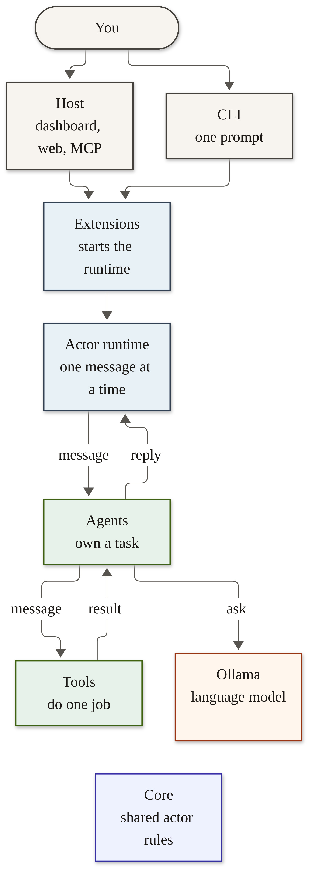

# Architecture Diagram

[Edit source](./architecture-diagram.mmd)

Agctor is a team of actors. An actor keeps its own work. It talks only by sending a message.

**You** start at the **Host** or the **CLI**. The Host is the dashboard, the web API, and the MCP listener. The CLI sends one prompt.

**Extensions** starts the actor runtime and connects those doors to it.

The **actor runtime** hands each message to one actor, then the next. The normal runtime is an in-memory mailbox. Proto.Actor and Orleans are optional. Orleans still runs the agents in that same mailbox.

**Agents** are actors that own a task. An agent can ask a child agent for help. The answer comes back as another message. Some agents remember a project or a scene. Some keep a map of the code.

**Tools** are actors too. They edit files, run code, compile, test, and look up memory. A tool does the job and sends a result. It does not start other agents.

An agent can call **Ollama** when it needs a language model.

**Core** sits under the picture. It is the shared rule book, not a stop on the path. It says what an actor is, what a message looks like, and what a tool may do.
