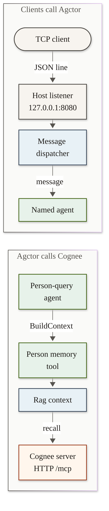

# MCP Diagram

[Edit source](./mcp-diagram.mmd)

## Agctor as a listener

A TCP client connects to the Host. The listener is `McpListener` in AgctorSDK.Host. It starts when the web app starts. It binds to `Mcp:Host` and `Mcp:Port`. The defaults are `127.0.0.1` and `8080`.

The client sends one JSON line. That line names a target agent and carries a payload. The listener wraps the line in a message envelope. `MessageDispatcher` delivers the envelope to that agent. The reply is JSON on the same connection, prefixed with a 4-byte length.

## Agctor calls Cognee

Agctor attaches one outside server, Cognee, from `Agctor:Rag:Cognee`. `BaseUrl` defaults to `http://127.0.0.1:8000`. `McpPath` defaults to `/mcp`. Extensions registers the HTTP transport and the Cognee adapter. The transport sends `initialize`, then `tools/call`.

A person-query or coaching flow asks the person memory tool for `BuildContext`. That tool asks Rag context for an appendix. When the provider is Cognee, the adapter calls `recall`. The text is placed in the agent prompt. Ingest calls `remember`. Dataset listing calls `list_datasets_json`. A health check calls `tools/list`.

Only Cognee is attached this way.
